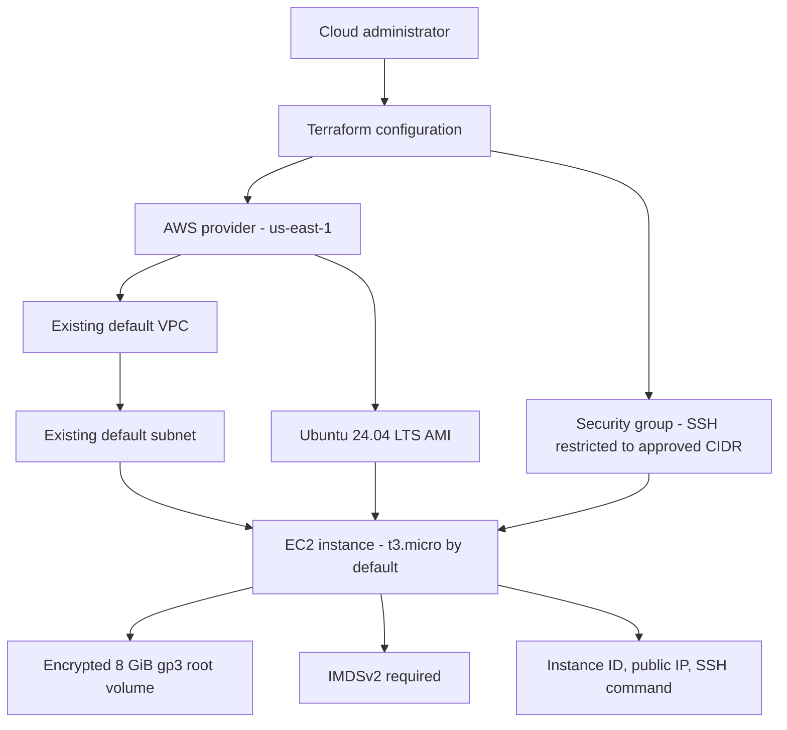
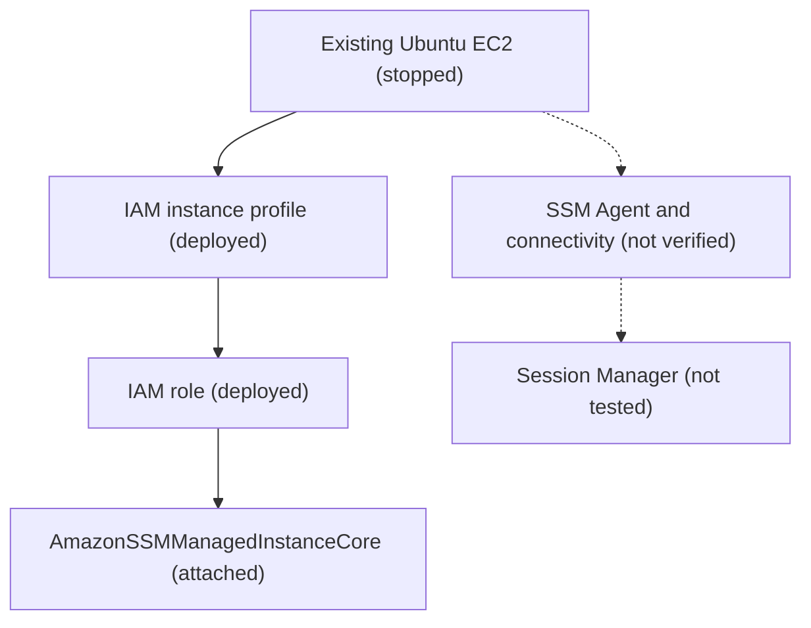
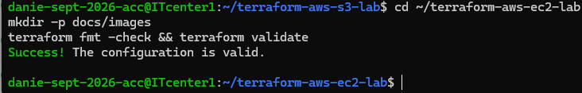
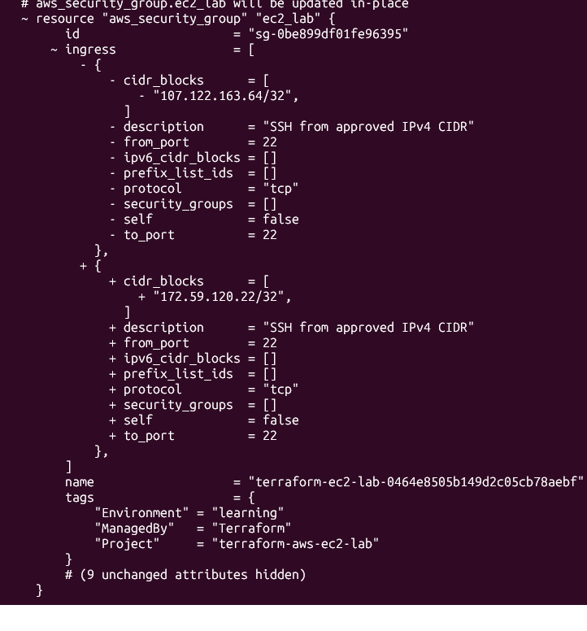
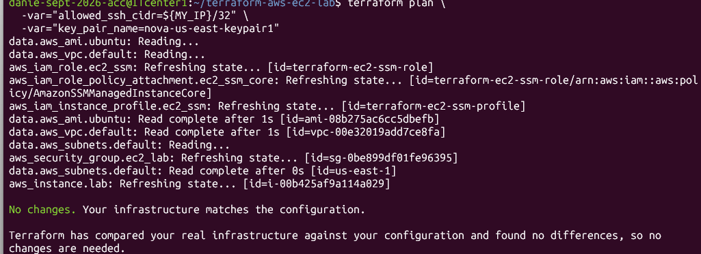

# AWS EC2 Lab with Terraform

## Project Overview

This project demonstrates how to define an Ubuntu EC2 instance and
its security group using Terraform. It is a learning project for AWS
Cloud System Administration and Infrastructure as Code.

## Technology Stack

- Amazon EC2
- Amazon VPC
- Amazon EBS
- Ubuntu Server 24.04 LTS
- Terraform
- AWS CLI
- Ubuntu Linux

## Infrastructure Defined

- One Ubuntu EC2 instance
- An existing default VPC and one of its default subnets
- A security group allowing SSH only from a configured IPv4 CIDR
- An encrypted 8 GiB gp3 root volume
- IMDSv2 required for instance metadata requests
- Resource tags for project, environment, and management
- Outputs for instance ID, public IPv4 address, and an example SSH command

## Prerequisites

- Terraform 1.5.0 or newer
- AWS CLI or another secure AWS credential configuration
- AWS permissions for EC2, security groups, and describing VPCs and AMIs
- An existing default VPC and default subnet in the selected Region
- An existing EC2 key pair in the selected Region

## Validate the Configuration

Initialize Terraform:

    terraform init

Format the files:

    terraform fmt

Check formatting without changing the files:

    terraform fmt -check

Validate the configuration:

    terraform validate

## Plan Before Deployment

Supply your existing EC2 key pair name and your public IPv4 address
in CIDR notation. For a single IPv4 address, the CIDR usually ends
in /32.

Example only—replace these placeholders with your own values:

    terraform plan \
      -var="key_pair_name=YOUR_EC2_KEY_PAIR_NAME" \
      -var="allowed_ssh_cidr=YOUR_PUBLIC_IP/32"

Review the plan before deciding whether to create any resources.

## Deployment Status

**Last verified: November 2026**

This Terraform project has been deployed to AWS.

| Component | Verified status |
|---|---|
| AWS Region | `us-east-1` |
| EC2 instance | `i-00b425af9a114a029` |
| Instance type | `t3.micro` |
| Operating system | Ubuntu Server 24.04 LTS |
| EC2 state | Stopped |
| VPC and subnet | Existing default AWS resources |
| Security group | Deployed; SSH restricted to approved IPv4 /32 |
| Root EBS volume | Encrypted 8 GiB gp3 |
| Public IPv4 | None while stopped |
| Terraform validation | Passed |
| Latest normal plan | No changes; Terraform matches deployed AWS resources |

### Infrastructure Protection

- `prevent_destroy = true` protects against accidental Terraform destruction.
- The Ubuntu AMI is pinned to prevent automatic AMI replacement.
- SSH is restricted to an approved IPv4 `/32` address.
- IMDSv2 is required.
- The EBS root volume is encrypted.

The explicit public-IP association setting was removed after
troubleshooting a replacement proposal while EC2 was stopped.

**Important:** The SSM IAM integration and SSH security-group update have been applied.
The latest Terraform plan reports no changes. EC2 remains stopped.

## Security Considerations

- SSH is restricted to a specified IPv4 CIDR.
- Do not allow SSH from 0.0.0.0/0.
- The root EBS volume is configured for encryption.
- IMDSv2 is required.
- Do not commit AWS credentials, private keys, Terraform state,
  or secret variable files.

## Cost Awareness

Creating an EC2 instance, public IPv4 address, or EBS volume may incur
charges depending on your AWS account and current pricing.

This repository documents the Terraform configuration. Running
terraform init and terraform validate does not create the EC2 instance.
Review costs and the Terraform plan before applying changes.

## Cleanup

If resources are deployed, review the Terraform state and plan before
destroying them. Run terraform destroy only when you understand which
resources the current state manages and intend to remove them.

## AWS Systems Manager — Deployed IAM Integration

Terraform has deployed the AWS Systems Manager (SSM) IAM integration
for the existing Ubuntu EC2 instance. Live SSM connectivity is not yet verified.

### Terraform Components

- `aws_iam_role.ec2_ssm`: IAM role trusted by the EC2 service.
- `aws_iam_role_policy_attachment.ec2_ssm_core`: Attaches the
  AWS-managed `AmazonSSMManagedInstanceCore` policy.
- `aws_iam_instance_profile.ec2_ssm`: Makes the IAM role available
  for attachment to the EC2 instance.
- `aws_instance.lab`: References the deployed IAM instance profile.

### Validation and Deployment Status

- Terraform configuration validation passed.
- Latest verified plan: No changes.
- The EC2 instance profile and SSH security-group updates are deployed.
- AWS CLI confirms the IAM instance profile and managed policy attachment.
- The existing EC2 instance was last verified as stopped.
- SSM Agent operation, outbound connectivity, and Session Manager
  access have not yet been verified.

### Security Objective

Session Manager may provide administrative access without opening
inbound SSH port 22, once the instance is correctly configured and
connectivity is verified.

The current SSH configuration remains restricted to an approved
IPv4 /32 address. Do not expose SSH to `0.0.0.0/0`.

## Future Improvements

- Add a dedicated VPC and subnet configuration
- Verify SSM Agent and test Session Manager access
- Add CloudWatch monitoring and alarms
- Automate validation through a CI/CD pipeline

## Architecture Diagram

This diagram represents the Terraform-managed infrastructure deployed
in AWS. The EC2 instance is currently stopped. The latest proposed
SSH security-group update has not been applied.

### Deployed AWS Systems Manager IAM Architecture

The following diagram shows the deployed IAM integration.
SSM Agent operation and Session Manager connectivity remain unverified.

Solid arrows represent verified IAM configuration relationships.
Dashed arrows represent unverified SSM Agent and Session Manager connectivity.

## Validation Screenshot

This screenshot records the Terraform formatting and validation
results. Validation does not prove that AWS resources were deployed.

## Terraform Plan Evidence

This screenshot records a normal Terraform plan reviewed on
November 14, 2026.

The plan showed:

- **0 resources to add**
- **1 security group to update in-place**
- **0 resources to destroy**

The proposed change updates the SSH access rule to the approved
client IPv4 address.

**Deployment status:** This security-group update has not been
applied to AWS. The existing EC2 instance remains stopped.

The plan also reflects the removal of the previous public IPv4
address from Terraform outputs because the instance is stopped.
## SSM IAM Deployment Verification

The latest Terraform plan reported no changes, confirming
that the deployed AWS resources match the Terraform configuration.

AWS CLI verification confirmed the EC2 IAM instance profile
and the AmazonSSMManagedInstanceCore policy attachment.

The EC2 instance remained stopped. SSM Agent operation and
Session Manager connectivity have not yet been tested.
