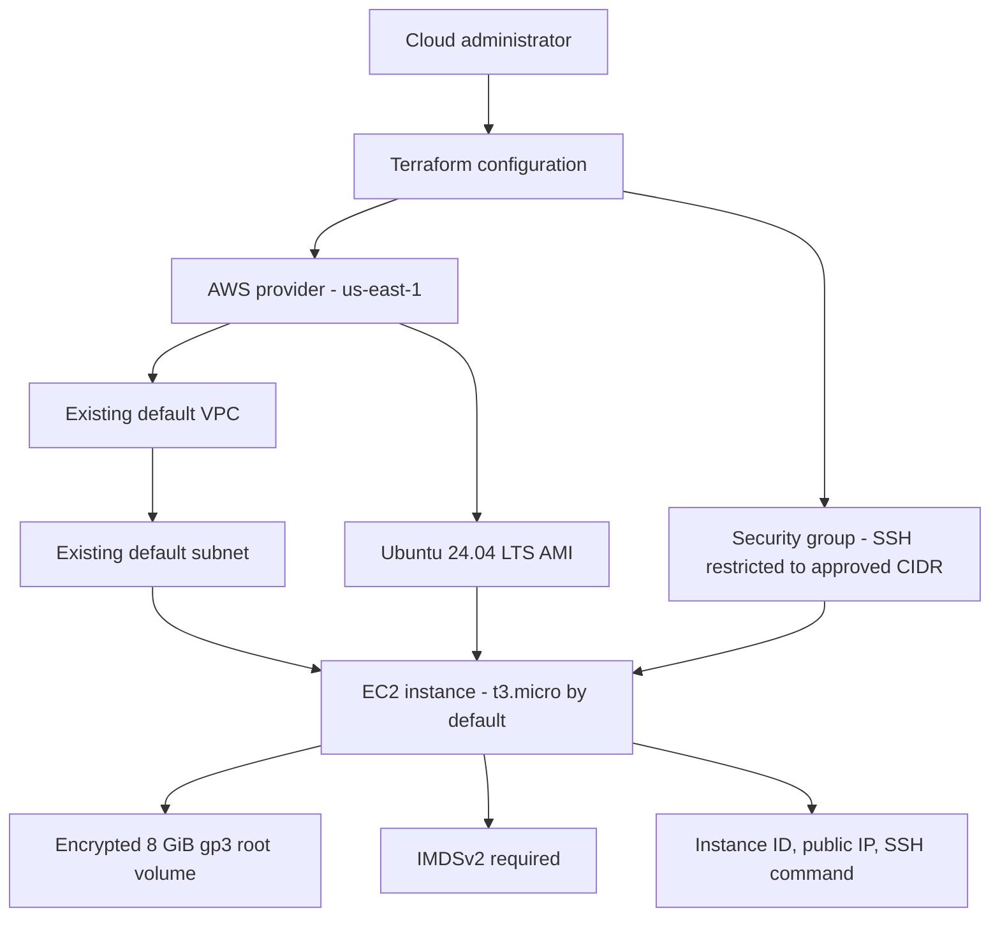
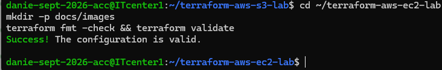

# AWS EC2 Lab with Terraform

## Project Overview

This project demonstrates how to define an Ubuntu EC2 instance and
its security group using Terraform. It is a learning project for AWS
Cloud System Administration and Infrastructure as Code.

## Technology Stack

- Amazon EC2
- Amazon VPC
- Amazon EBS
- Ubuntu Server 24.04 LTS
- Terraform
- AWS CLI
- Ubuntu Linux

## Infrastructure Defined

- One Ubuntu EC2 instance
- An existing default VPC and one of its default subnets
- A security group allowing SSH only from a configured IPv4 CIDR
- An encrypted 8 GiB gp3 root volume
- IMDSv2 required for instance metadata requests
- Resource tags for project, environment, and management
- Outputs for instance ID, public IPv4 address, and an example SSH command

## Prerequisites

- Terraform 1.5.0 or newer
- AWS CLI or another secure AWS credential configuration
- AWS permissions for EC2, security groups, and describing VPCs and AMIs
- An existing default VPC and default subnet in the selected Region
- An existing EC2 key pair in the selected Region

## Validate the Configuration

Initialize Terraform:

    terraform init

Format the files:

    terraform fmt

Check formatting without changing the files:

    terraform fmt -check

Validate the configuration:

    terraform validate

## Plan Before Deployment

Supply your existing EC2 key pair name and your public IPv4 address
in CIDR notation. For a single IPv4 address, the CIDR usually ends
in /32.

Example only—replace these placeholders with your own values:

    terraform plan \
      -var="key_pair_name=YOUR_EC2_KEY_PAIR_NAME" \
      -var="allowed_ssh_cidr=YOUR_PUBLIC_IP/32"

Review the plan before deciding whether to create any resources.

## Security Considerations

- SSH is restricted to a specified IPv4 CIDR.
- Do not allow SSH from 0.0.0.0/0.
- The root EBS volume is configured for encryption.
- IMDSv2 is required.
- Do not commit AWS credentials, private keys, Terraform state,
  or secret variable files.

## Cost Awareness

Creating an EC2 instance, public IPv4 address, or EBS volume may incur
charges depending on your AWS account and current pricing.

This repository documents the Terraform configuration. Running
terraform init and terraform validate does not create the EC2 instance.
Review costs and the Terraform plan before applying changes.

## Cleanup

If resources are deployed, review the Terraform state and plan before
destroying them. Run terraform destroy only when you understand which
resources the current state manages and intend to remove them.

## Future Improvements

- Add a dedicated VPC and subnet configuration
- Add Systems Manager access as an alternative to SSH
- Add CloudWatch monitoring and alarms
- Automate validation through a CI/CD pipeline

## Architecture Diagram

This diagram describes the infrastructure defined by this Terraform
project. It does not establish that the resources have been deployed
in AWS.

## Validation Screenshot

This screenshot records the Terraform formatting and validation
results. Validation does not prove that AWS resources were deployed.
