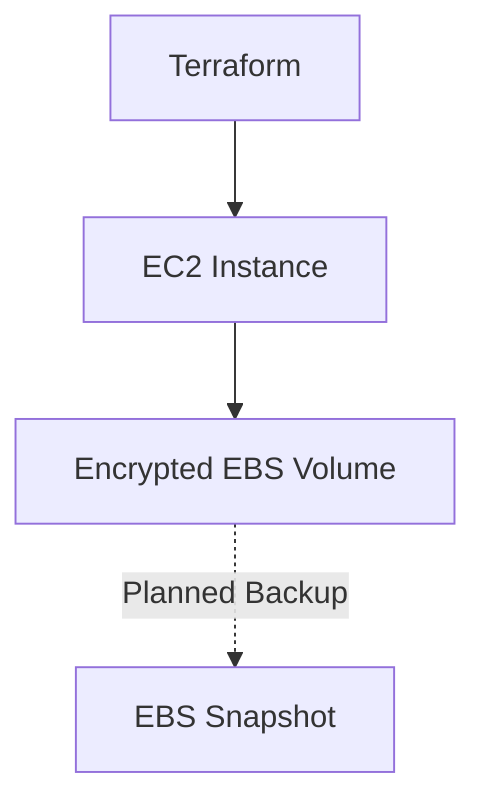
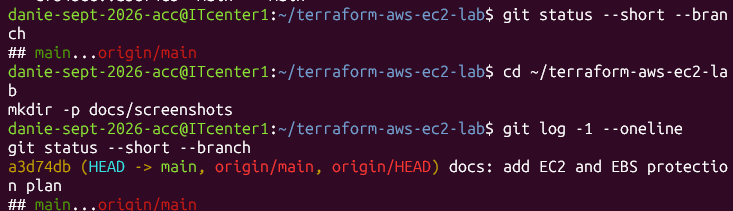

# AWS EC2 and EBS Protection Plan

## Project
terraform-aws-ec2-lab

## Previously Verified Resources
- Region: us-east-1
- EC2 instance: i-00b425af9a114a029
- Last observed EC2 state: stopped
- EBS volume: 8 GiB gp3, encrypted
- Terraform prevent_destroy: true

## Planned Improvements — NOT DEPLOYED
1. Review EC2 termination protection.
2. Review EBS root-volume retention.
3. Plan an EBS snapshot backup.

## Architecture

## GitHub Portfolio Evidence

The following screenshot documents Git validation
for this Terraform EC2 and EBS project.

### Validation Status
- Git commit: Verified
- GitHub push: Verified
- Screenshot: Captured locally
- EBS snapshot: Planned, not deployed
## AWS CLI EBS Backup Assessment

### Verified Findings
- EC2 instance: i-00b425af9a114a029
- EBS volume: vol-0fe561df473bb8919
- AWS Region: us-east-1
- Volume type: gp3
- Volume size: 8 GiB
- Encryption: enabled
- Device: /dev/sda1
- Attachment: attached
- DeleteOnTermination: true
- Account-owned snapshots returned: none

### Risk Assessment
The root EBS volume is configured for deletion
when its EC2 instance is terminated.

No account-owned snapshot was returned by the
AWS CLI query for this volume.

Terraform prevent_destroy does not protect against
every deletion outside Terraform.

### Planned Actions — NOT DEPLOYED
1. Review EC2 API termination protection.
2. Review root EBS volume retention.
3. Evaluate creating an encrypted EBS snapshot.
4. Verify backup recovery procedures.
5. Document snapshot storage costs.

### Validation
Source: AWS CLI describe-volumes and
describe-snapshots commands.

No AWS resources were changed during this assessment.
