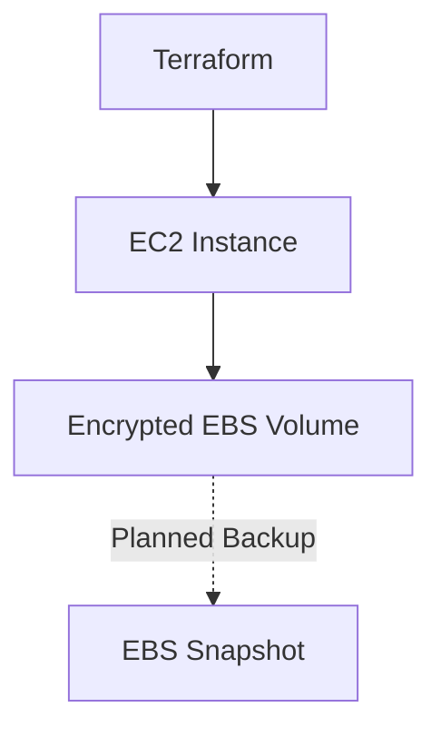

# AWS EC2 and EBS Protection Plan

## Project
terraform-aws-ec2-lab

## Previously Verified Resources
- Region: us-east-1
- EC2 instance: i-00b425af9a114a029
- Last observed EC2 state: stopped
- EBS volume: 8 GiB gp3, encrypted
- Terraform prevent_destroy: true

## Planned Improvements — NOT DEPLOYED
1. Review EC2 termination protection.
2. Review EBS root-volume retention.
3. Plan an EBS snapshot backup.

## Architecture

